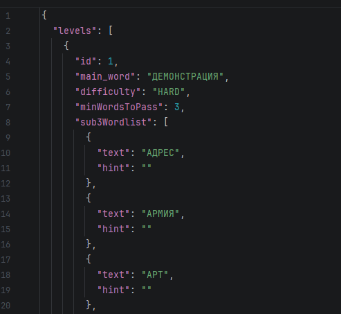
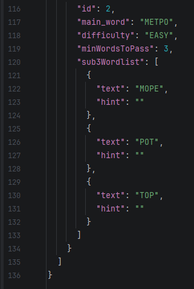

# Words from word — level generator

Java module that generates game levels in JSON format from a Russian word dictionary and a list of main words.

---
## Requirements
* JDK 17+
* Maven 3.9.x+
---

## How to build and run
### Build
1) check your java:```java --version```
2) download Maven and unpack it (https://maven.MMVapache.org/download.cgi)
3) add Maven to PATH:
    * search "Modifying System Environment Variables"
    * click environment variables
    * search for PATH and click edit->create
    * paste path like ```C:\Program Files\Apache\maven\bin```
    * save and close
4) check it's version in powershell: ```mvn -v```(should version of Maven appear)
5) go to the cloned repository to build the project; to do this, run the command ```mvn clean compile```
### Run

To run the project in the terminal, you need to write and execute a command ```mvn exec::java```

---
## How this algorithm working?
1) Reads `config.json`, `data/main_words.json`, `data/dict.json`
2) All words in dict are converted to a single case (`Ё → Е`)
3) words whose length is `>= minSubWordLength` are kept duplicates are removed

4) for each main word
* find sub words that can be created from its letter(check letter freq)
* exclude the main word
* if number of sub words < `minWordsToPass` -> skip
* calculate difficulty
5) make result .json file

### Letter check rule

A sub word is valid if every letter appears in the main word at least as many times as in the sub-word

Example:
* main word - MAMA
* MAM -> valid
* MAMMA -> invalid

---
## Calculating Difficulty
   `main` word length `<= easyMaxMainWordLength` -> EASY
   
   `number` of sub-words `<= easyMaxSubWords` -> EASY
   
   `main_word` length `<= mediumMaxMainWordLength` -> MEDIUM
   
   `number` of sub-words `<= mediumMaxSubWords` -> MEDIUM

   if none of the conditions are met -> automatically HARD

---

## Input example
config.json
```
{
"minSubWordLength": 3,
  "minWordsToPass": 3,
  "difficultyThresholds": {
    "easyMaxMainWordLength": 7,
    "mediumMaxMainWordLength": 10,
    "easyMaxSubWords": 15,
    "mediumMaxSubWords": 30
  }
```
main_words.json
```
["ДЕМОНСТРАЦИЯ", "МЕТРО"]
```
dict.json
```
[
  "десант", "адрес", "армия", "место", "метро",
  "демон", "страна", "рация", "монстр", "мода",
  "море", "род", "дом", "нос", "сон", "рот",
  "тор", "мат", "там", "акт", "кот", "ток",
  "рак", "кар", "имя", "зима", "сила", "лист",
  "стол", "лось", "соль", "астр", "трас", "раст",
  "старт", "арт", "тар", "рат", "еда", "май"
]
```
## Output example





---

## License

This project have MIT license 

